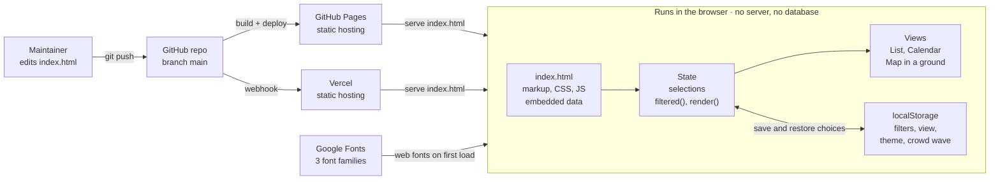
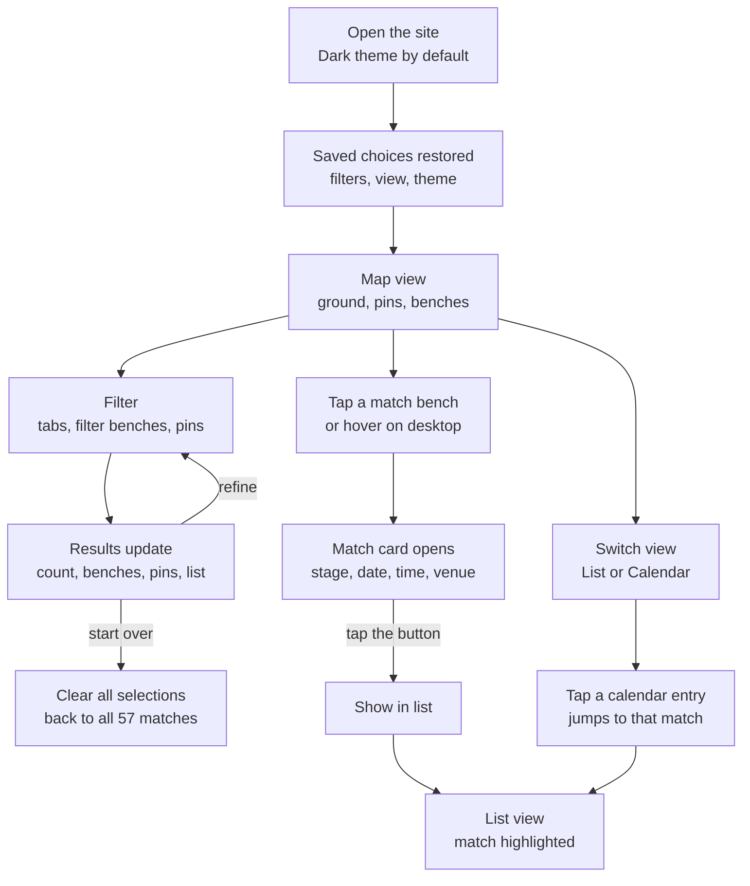
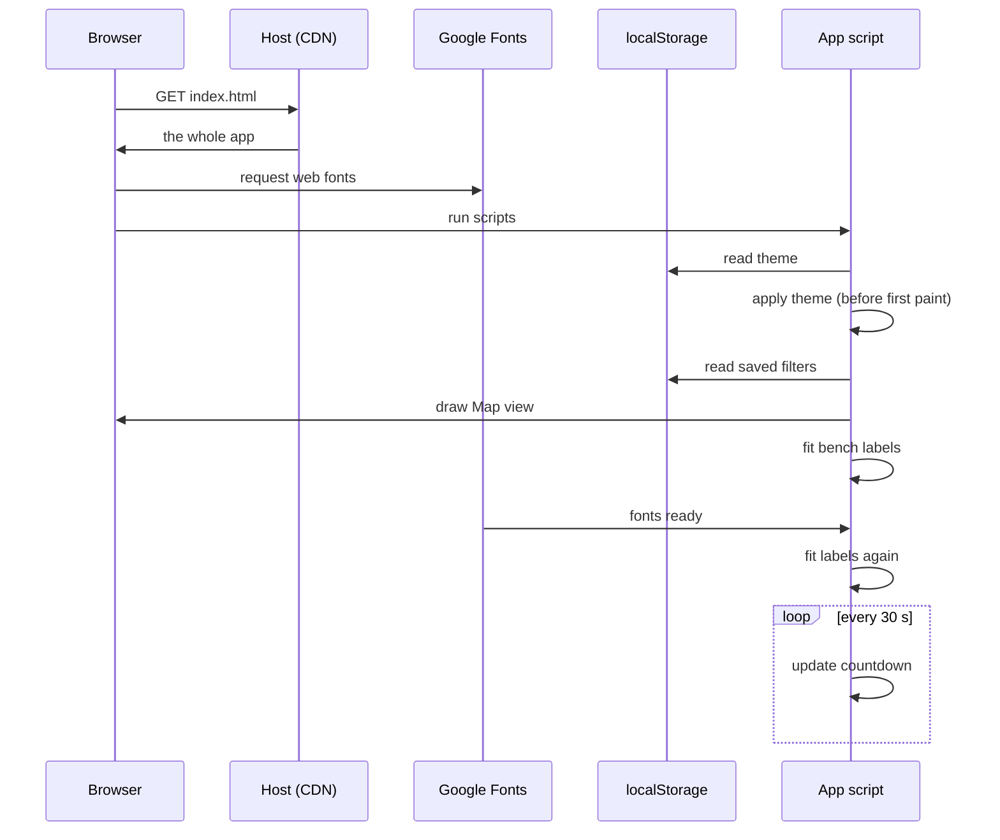
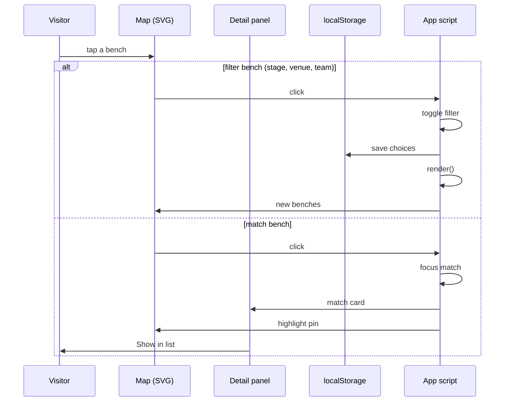
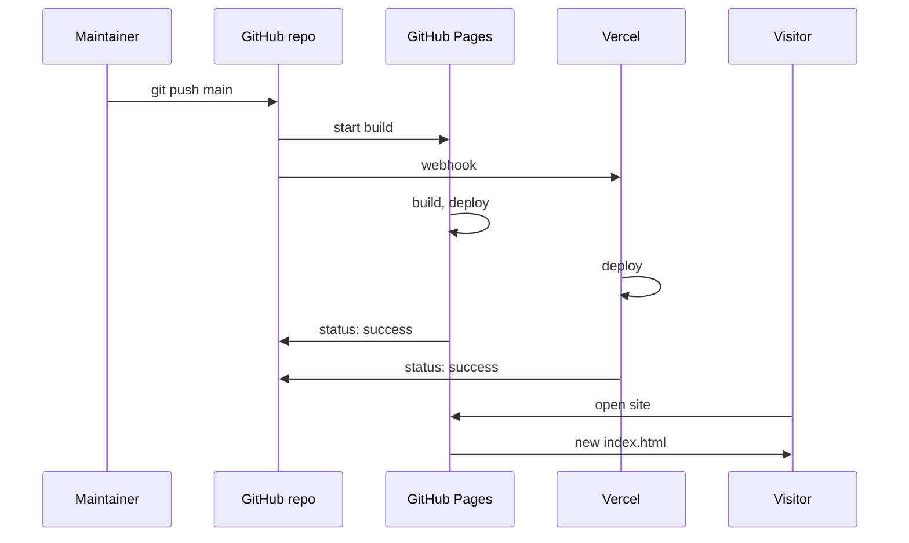

# World Cup 2027 Fixtures – Architecture

As of 2026-10-12 · latest commit at time of writing: `b1b1c31`

## Overview

The site is one static HTML file with no server, database or build step. Every fixture, venue and map shape is embedded in the page, and all interaction runs in the visitor's browser.

It shows the 57 fixtures of the ICC Men's Cricket World Cup 2027 (South Africa, Zimbabwe, Namibia; 2 October – 21 November 2027) in three views: a filterable list, a calendar, and a map drawn inside a cricket ground whose stands are made of match benches.

| Item | Value |
| --- | --- |
| Live (GitHub Pages) | https://bharathdrive-ai.github.io/cricketworldcup2027schedule/ |
| Live (Vercel) | https://cricketworldcup2027schedule.vercel.app |
| Source | https://github.com/bharathdrive-ai/cricketworldcup2027schedule, branch `main` |
| Files | `index.html` (the whole app), `README.md`, `ARCHITECTURE.md`, `.nojekyll` |
| Stack | HTML, CSS custom properties, vanilla JavaScript, inline SVG; Google Fonts (Big Shoulders Display, Instrument Sans, JetBrains Mono) |

## System architecture



Pushing to `main` is the only deployment step. After that the browser does all the work, talking only to whichever host served the page and to Google Fonts.

## Inside index.html

The page is organised as layers in one file. The embedded data feeds one in-memory state object, a single `render()` function redraws the active view from that state, and every interaction changes the state and calls `render()` again.

| Layer | Main pieces | What it does |
| --- | --- | --- |
| Styles | `:root` tokens; `[data-theme]` blocks for Light, Dark, Green, Sunset | All colours are CSS custom properties, so a theme swap is one attribute on `<html>` |
| Early theme script | Inline script in `<head>` | Applies the saved theme (default Dark) before first paint, so the page never flashes the wrong theme |
| Data | `VENUES`, `SEEDS`, `STAGES`, `RAW`, `COORD`, `GEO` | Fixtures, grounds, Super 7 seeds, stage labels, venue lat/lon and label offsets, pre-projected country borders |
| Derived model | `matches`, `TEAMS`, `GROUP`, `DAYS` | Each `RAW` row becomes a match object with date, sides, venue details and stage |
| State and persistence | `state` (teams, venues, dates, stages, date range, search, view, tab); `save()` | Holds the current selections; written to the browser's `localStorage` after every render |
| Filtering | `filtered()` | Returns the matches that pass every active filter. Picks within one category add matches; picks across categories narrow them |
| Views | `renderList()`, `renderCal()`, `renderVenues()` | Build HTML strings for the List, Calendar and Map views; `render()` puts the active one into `#out` |
| Ground map | `renderMap()`, `proj()`, `pinXY()`, `benchesSVG()`, `filterBenchItems()`, `waveSVG()` | Draws the map inside a cricket ground: country shapes, venue pins and labels, pitch, stands of match and filter benches, crowd wave |
| Label fitting | `fitBenches()` | After drawing, measures each bench label and shrinks it until it sits inside its bench; reruns when web fonts finish loading |
| Detail panel | `detailHTML()`, `setFocusVenue()` | Shows the focused venue or match beside the map without a full redraw |
| Events | Delegated listeners on `#out`, the picker, the view switch, the theme switch | Translate clicks, taps, hover, focus and Enter/Space into state changes |
| Countdown | `tick()` | Updates days/hours/minutes to the first ball every 30 seconds |

## Data model

The schedule is stored in `index.html` itself, as the JavaScript list `RAW` (around line 439). It has one row per match, 57 rows in all, with the venues, seeds and stages defined just above it.

| Constant | Holds |
| --- | --- |
| `VENUES` | 12 grounds: stadium, country, capacity, alternate city name |
| `SEEDS` | Super 7 slots A1 India … AB4 England |
| `STAGES` | Stage names and date ranges for the strip at the top |
| `RAW` | The 57 fixtures |

Each `RAW` row has seven fields:

```js
[9, "10-10", "India", "Pakistan", "Johannesburg", "ga", "D"]
```

| Field | Example | Meaning |
| --- | --- | --- |
| Match number | `9` | 1–57 |
| Date | `"10-10"` | Month-day in 2027 |
| Home, away | `"India"`, `"Pakistan"` | Team name, or a placeholder: `Qualifier A/B`, `Super Series 1–3`, seed slot (`A1` … `AB4`), `Super 7 1st`, `Winner SF1` |
| Venue | `"Johannesburg"` | Key into `VENUES` |
| Stage | `"ga"` | `ss` Super Series, `ga`/`gb` Group A/B, `s7` Super 7, `sf` semi-final, `f` final |
| Start | `"D"` | `D` = 10:00 day, `N` = 12:30 day/night (local, SAST) |

Each visitor's choices are kept only in their own browser (`localStorage`) and are never sent anywhere.

| Key | Holds |
| --- | --- |
| `cwc27v2` | Selected teams, venues, dates, stages, date range, head-to-head, view, open tab |
| `cwc27theme` | System, Light, Dark, Green or Sunset |
| `cwc27wave` | Crowd wave on or off |

## User flow



You can refine filters again from any result, and every choice is remembered for the next visit. The theme switch at the top works at any step.

## Sequence diagrams

### Page load



A small script in the page head applies the saved theme, so the page never flashes the wrong colours. Bench labels are measured once after drawing and again when the web fonts arrive, because the fonts change text widths.

### Tapping a bench



A filter bench changes the selections, so the whole view is redrawn and the choice is saved. A match bench only updates the detail panel and the highlights, so nothing is redrawn or saved.

## Deployment



There is no build step: both hosts publish `index.html` exactly as it is. GitHub Pages runs its own build, deploy and status jobs. Vercel's GitHub app deploys to Production and reports a "Vercel" status on the commit. Both hosts finish in about a minute. A visitor gets the new file on their next visit, or after Ctrl+F5 if their browser has cached the old one. A rollback takes the same path: a `git revert` commit pushed to `main`.

## Quality attributes

The design aims for zero infrastructure and readability at every screen size. The main trade-off is that bench text is too small to read on phones when all 57 matches show.

| Attribute | How it is met |
| --- | --- |
| Responsiveness | Breakpoints at 760 px and 420 px. Below 760 px: phone label positions, larger tap targets, and 16 px inputs so iOS does not zoom. Below 420 px: the theme switch fills the width. Checked at 327, 375, 1024 and 1280 px with no sideways scrolling. |
| Map legibility | Venue labels have separate desktop and phone positions. Close pins (Johannesburg/Centurion, Paarl) are nudged apart. A measured fit keeps every bench label inside its bench. |
| Themes and contrast | Five theme options (System, Light, Dark as default, Green, Sunset). Text contrast is at least 4.5:1 and map symbol contrast at least 3:1. |
| Accessibility | Pins, benches and chips are buttons with `aria-label` and `aria-pressed`. Enter and Space work, and focus outlines are visible. Animations and transitions stop when the device asks for reduced motion. |
| Performance | One HTML request plus web fonts, with no frameworks. Benches are plain SVG paths, the crowd wave is one rotating shape, and the map redraws only when the state changes. |
| Privacy | No accounts, analytics, cookies or server calls. Selections stay in the visitor's own browser. |
| Availability | Served as a static file from two hosts (GitHub Pages and Vercel); either one can serve the site on its own. |

## Operations

Every change is one edit to `index.html` pushed to `main`, and both hosts redeploy automatically within about a minute.

**Update a fixture**

1. Edit the match's row in `RAW` (date, teams, venue, stage or start time).
2. Commit and push to `main`.
3. Check that the live page serves the new file by comparing it with the commit, then open the Map, List and Calendar views.

**Roll back**

1. Preferred: `git revert <commit>` and push. This keeps the history, and both sites redeploy.
2. Only if explicitly asked: reset `main` to an earlier commit and force-push. This was done once, on 2026-10-02 (to `3def990`); the removed commits are kept on the local branch `backup-before-reset-to-3def990`.

**Known limitations**

- Fixtures are typed in by hand from the ICC schedule, and start times come from Wikipedia. South Africa v New Zealand (match 8) uses 8 October, the date in the ICC media release.
- Qualifier A/B and the three Super Series sides are placeholders until the qualifying tournament in March 2027.
- On phones, bench text is about 4–5 px when all 57 matches show; tapping a bench opens its details.
- The "Ask the schedule" agent answers only from the schedule PDF, so the PDF must be rebuilt (tools/build-pdf.js) after any fixture change. It needs GOOGLE_API_KEY in Vercel and shares the free-tier Gemini quota.
- The crowd wave is a faint, soft-edged glow in the theme's accent colour drawn over the benches; labels stay readable as it passes, and it can be switched off.
